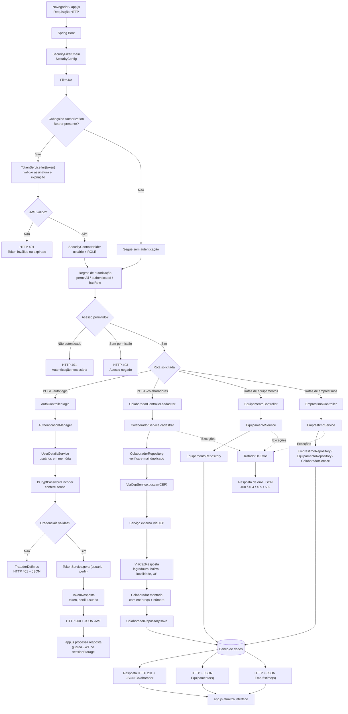
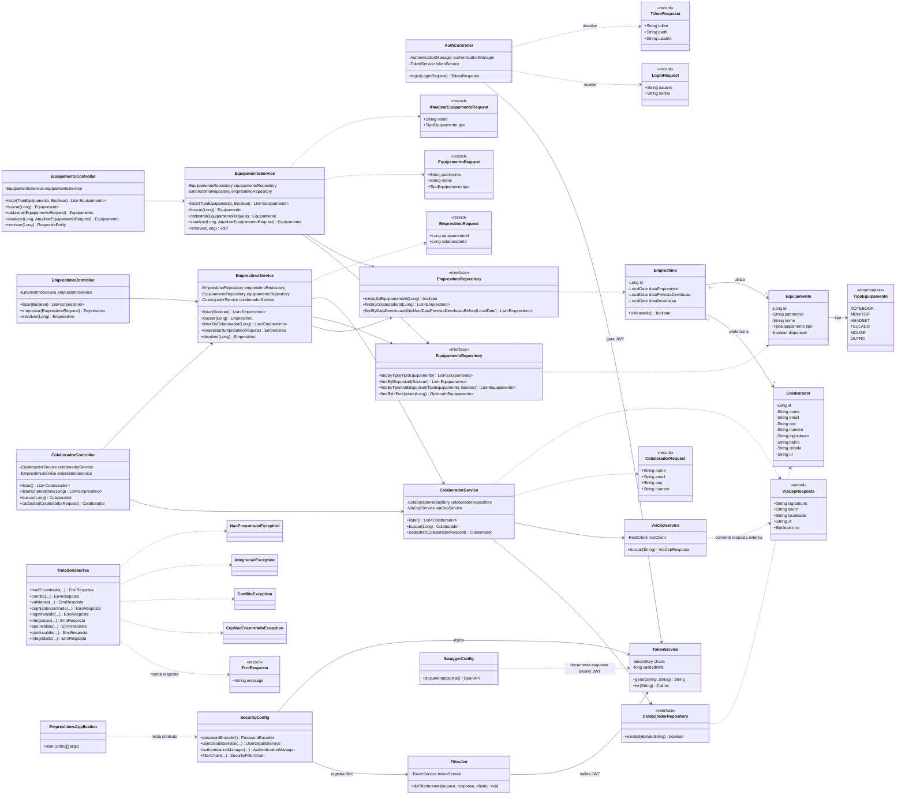

# 📘 Sistema de Empréstimo de Equipamentos

<p align="center">


</p>

---

**Sistema desenvolvido com Java, Spring Boot, Spring Security e Python.**

Solução criada para facilitar o gerenciamento de equipamentos, colaboradores, empréstimos e devoluções, oferecendo mais organização, segurança e controle operacional.

---

## 📑 Sumário

1. [Sobre o Projeto](#-1-sobre-o-projeto)
2. [Funcionalidades](#-2-funcionalidades-do-sistema)
3. [Tecnologias Utilizadas](#-3-tecnologias-utilizadas)
4. [Arquitetura e Diagramas](#-4-arquitetura-e-diagramas-do-sistema)
5. [Estrutura de Pastas e Camadas](#-5-estrutura-de-pastas-e-camadas)
6. [Como Executar o Projeto](#-6-como-executar-o-projeto)
7. [Autenticação e Segurança JWT](#-7-autenticação-e-segurança-jwt)
8. [Principais Rotas da API](#-8-principais-rotas-da-api)
9. [Exemplos de Requisições JSON](#-9-exemplos-de-requisições-json)
10. [Relatório Automático com Python](#-10-relatório-automático-com-python)
11. [Integrantes da Equipe](#-11-integrantes-da-equipe)
12. [Objetivo do Projeto](#-12-objetivo-do-projeto)

---

## 📌 1. Sobre o projeto

### Qual problema queremos resolver?

Atualmente, o controle de equipamentos realizado por meio de planilhas manuais costuma gerar diversos gargalos operacionais, tais como:

- Dificuldade para identificar rapidamente quais equipamentos estão disponíveis.
- Risco de emprestar o mesmo equipamento para duas pessoas simultaneamente.
- Falta de controle rigoroso sobre devoluções atrasadas.
- Dificuldade para consultar o histórico completo de movimentações.

Este projeto soluciona esses problemas centralizando o cadastro de equipamentos e colaboradores, automatizando regras de disponibilidade e facilitando o acompanhamento de devoluções e relatórios.

---

## 🚀 2. Funcionalidades do sistema

- **Gestão de Equipamentos:** Cadastro com número de patrimônio único, edição, listagem com filtros e remoção.
- **Gestão de Colaboradores:** Cadastro integrado com preenchimento automático de endereço via **ViaCEP**.
- **Controle de Empréstimos:** Registro de empréstimos com prazo padrão de 14 dias e bloqueio automático para itens já emprestados.
- **Devoluções:** Registro de devolução com liberação imediata do equipamento no estoque.
- **Monitoramento de Atrasos:** Consulta dedicada para identificação de empréstimos com prazo vencido.
- **Segurança e Perfis:** Autenticação stateless via JWT com controle de acesso baseado em perfis (`ADMIN` e `COLABORADOR`).
- **Relatórios Gerenciais:** Exportação automatizada em Excel (`.xlsx`) via script Python contendo abas de empréstimos atrasados e quantitativo por tipo de equipamento.

---

## 🛠️ 3. Tecnologias utilizadas

| Camada / Área | Tecnologia | Finalidade |
| --- | --- | --- |
| **Back-end** | Java 25 & Spring Boot 4.1.2 | Base da aplicação e injeção de dependências |
| **Build** | Maven | Gerenciamento de dependências e compilação |
| **Web / API** | Spring Web & Bean Validation | Rotas REST e validação de entrada |
| **Persistência** | Spring Data JPA, Hibernate & H2 | Mapeamento objeto-relacional e banco de dados local |
| **Segurança** | Spring Security, JJWT 0.12.6 & BCrypt | Autenticação JWT, criptografia e controle de rotas |
| **Integrações** | RestClient & ViaCEP | Consumo de API externa para consulta de CEP |
| **Documentação** | Springdoc OpenAPI / Swagger UI | Documentação interativa e testes dos endpoints |
| **Testes** | JUnit 5, Spring Boot Test & Postman | Testes automatizados, integração e validação de rotas |
| **Front-end** | HTML5 & JavaScript (`app.js`) | Interface web e consumo da API com `sessionStorage` |
| **Relatórios** | Python 3, Requests, Pandas & OpenPyXL | Extração de dados da API e geração de planilhas Excel |

---

## 🏗️ 4. Arquitetura e Diagramas do Sistema

O projeto adota uma **arquitetura em camadas**, isolando regras de negócio na camada `Service`, expondo contratos REST na camada `Controller` e persistindo dados via `Repository`.

### Visão Geral e Integrações Externas

```text
   USUÁRIO ──► INTERFACE WEB (app.js) ──► CONTROLLER ──► SERVICE ──► REPOSITORY ──► BANCO H2
                                                            │
                                                            └──► ViaCEP (Consulta de Endereço)

   API REST ──► SCRIPT PYTHON (Pandas / OpenPyXL) ──► Relatório Excel (.xlsx)
```

### 4.1. Fluxo Geral das Requisições (Spring Security & Rotas)

O diagrama abaixo representa a cadeia de filtros do Spring Security, validação do token JWT, autorização por perfil e o roteamento para os serviços e integrações:



### 4.2. Diagrama de Sequência: Registrar Empréstimo (`POST /emprestimos`)

Detalhamento completo desde a interação do usuário no navegador até a persistência transacional no banco H2, contemplando todos os cenários de erro (`400`, `401`, `403`, `404` e `409`):


### 4.3. Diagrama de Classes (UML)

Estrutura completa de controllers, services, repositories, entidades, DTOs, configuração de segurança e tratamento global de exceções:



#### Notas Técnicas da Arquitetura
- **Segurança & Sessão:** `SecurityConfig` libera `/auth/login` e recursos estáticos; `FiltroJwt` valida o token Bearer antes dos controllers. Os usuários de demonstração são gerenciados em memória pelo `InMemoryUserDetailsManager`.
- **Relacionamentos JPA:** `Emprestimo` mantém vínculo `@ManyToOne` com `Colaborador` e `Equipamento`, permitindo rastrear o histórico completo de uso de cada ativo.
- **Camada Front-end:** `app.js` gerencia o estado da aplicação no navegador, armazenando o JWT em `sessionStorage` e atualizando a interface dinamicamente.

---

## 📂 5. Estrutura de pastas e camadas

| Pasta / Diretório | Responsabilidade |
| --- | --- |
| `model` | Entidades JPA e enums do domínio (`Colaborador`, `Equipamento`, `Emprestimo`, `TipoEquipamento`) |
| `repository` | Interfaces Spring Data JPA para consultas e persistência |
| `service` | Regras de negócio, controle transacional e integração com ViaCEP |
| `controller` | Exposição dos endpoints REST e tratamento de requisições HTTP |
| `dto` | Records para transferência e validação de dados (`Request` e `Resposta`) |
| `security` | Configuração do Spring Security, geração e validação de tokens JWT |
| `exception` | Exceções customizadas e handler global (`TratadorDeErros`) |
| `resources/static` | Interface web (HTML, CSS e `app.js`) |
| `relatorio-python` | Scripts Python responsáveis pela extração e geração de relatórios Excel |

---

## 💻 6. Como executar o projeto

### Pré-requisitos

- **Java JDK 17** ou superior (projeto configurado com Java 25).
- **Maven** instalado ou uso do wrapper `./mvnw`.
- **Python 3** (opcional, apenas para execução dos relatórios em Excel).
- IDE de sua preferência (IntelliJ IDEA, VS Code ou NetBeans) e **Postman** (opcional).

### Passo a passo

1. **Clone o repositório:**
   ```bash
   git clone URL_DO_REPOSITORIO
   ```

2. **Acesse o diretório do projeto:**
   ```bash
   cd nome-do-projeto
   ```

3. **Compile e execute a aplicação via Maven:**
   ```bash
   mvn spring-boot:run
   ```
   *(Caso prefira usar uma IDE, importe o arquivo `pom.xml` como um projeto Maven e execute a classe `EmprestimosApplication`.)*

### Endereços da aplicação

| Serviço | URL de Acesso |
| --- | --- |
| **Sistema Web** | `http://localhost:8080` |
| **Swagger UI** | `http://localhost:8080/swagger-ui/index.html` |
| **Console H2** | `http://localhost:8080/h2-console` |

### Configuração do Banco de Dados H2

| Parâmetro | Valor |
| --- | --- |
| **JDBC URL** | `jdbc:h2:file:./dados/emprestimos` |
| **Usuário** | `sa` |
| **Senha** | *(deixar em branco)* |

---

## 🔐 7. Autenticação e segurança JWT

O sistema utiliza **JWT (JSON Web Token)** para autenticar usuários e controlar o acesso às rotas protegidas.

### Perfis de acesso

- **`ADMIN`:** Permissão total para cadastrar equipamentos, registrar colaboradores, efetuar empréstimos e dar baixa em devoluções.
- **`COLABORADOR`:** Permissão de leitura para consultar equipamentos, empréstimos e histórico vinculado.

### Usuários de demonstração

| Perfil | Usuário | Senha |
| --- | --- | --- |
| `ADMIN` | `admin` | `admin123` |
| `COLABORADOR` | `colaborador` | `colab123` |

> ⚠️ **Atenção:** Essas credenciais são configuradas em memória exclusivamente para testes e demonstração local. Não utilize essas senhas em ambientes de produção.

### Analogia de funcionamento

- **`AuthController`:** Recepção que valida usuário e senha.
- **`TokenService`:** Emissor do crachá digital temporário (token JWT).
- **`FiltroJwt`:** Segurança que inspeciona o crachá em cada requisição.
- **`SecurityConfig`:** Mapa de permissões que define quais salas são públicas ou restritas a administradores.

### Como testar o login via Postman

1. Envie uma requisição `POST` para `http://localhost:8080/auth/login` com o corpo (`raw` → `JSON`):
   ```json
   {
     "usuario": "admin",
     "senha": "admin123"
   }
   ```
2. Copie o valor do campo `token` retornado na resposta.
3. Nas próximas requisições, acesse a aba **Authorization**, selecione **Bearer Token** e cole o token gerado.

---

## 📖 8. Principais rotas da API

| Método | Rota | Descrição | Permissão |
| --- | --- | --- | --- |
| `POST` | `/auth/login` | Autentica usuário e retorna token JWT | Público |
| `GET` | `/equipamentos` | Lista equipamentos (aceita filtros) | Logado |
| `GET` | `/equipamentos/{id}` | Busca equipamento por ID | Logado |
| `POST` | `/equipamentos` | Cadastra novo equipamento | `ADMIN` |
| `PUT` | `/equipamentos/{id}` | Atualiza dados de um equipamento | `ADMIN` |
| `DELETE` | `/equipamentos/{id}` | Remove um equipamento | `ADMIN` |
| `GET` | `/colaboradores` | Lista todos os colaboradores | `ADMIN` |
| `GET` | `/colaboradores/{id}` | Busca colaborador por ID | `ADMIN` |
| `POST` | `/colaboradores` | Cadastra colaborador (consulta ViaCEP) | `ADMIN` |
| `GET` | `/colaboradores/{id}/emprestimos` | Lista empréstimos de um colaborador | Logado |
| `POST` | `/emprestimos` | Registra um novo empréstimo | `ADMIN` |
| `PUT` | `/emprestimos/{id}/devolucao` | Registra devolução de equipamento | `ADMIN` |
| `GET` | `/emprestimos` | Lista todos os empréstimos | Logado |
| `GET` | `/emprestimos?atrasados=true` | Filtra apenas empréstimos atrasados | Logado |

---

## 📝 9. Exemplos de requisições JSON

### Cadastro de Equipamento (`POST /equipamentos`)
```json
{
  "patrimonio": "NB-0001",
  "nome": "Notebook Dell",
  "tipo": "NOTEBOOK"
}
```

### Cadastro de Colaborador (`POST /colaboradores`)
```json
{
  "nome": "Ana Souza",
  "email": "ana@empresa.com",
  "cep": "01310100",
  "numero": "1000"
}
```

### Registro de Empréstimo (`POST /emprestimos`)
```json
{
  "equipamentoId": 1,
  "colaboradorId": 1
}
```

---

## 📊 10. Relatório automático com Python

A pasta `relatorio-python` contém a automação responsável por consumir os endpoints da API e consolidar indicadores gerenciais em Excel.

### Como executar

1. Acesse a pasta do script:
   ```bash
   cd relatorio-python
   ```

2. Instale as dependências necessárias:
   ```bash
   pip install -r requirements.txt
   ```

3. Execute o gerador de relatórios (com a API Java em execução):
   ```bash
   python gerar_relatorio.py
   ```

### Arquivo gerado

O script produzirá o arquivo `relatorio_emprestimos.xlsx` estruturado em duas abas:
- **Atrasados:** Relação detalhada de todos os empréstimos com data prevista expirada.
- **Emprestados por tipo:** Consolidado quantitativo de equipamentos em uso agrupados por categoria.

---

## 👥 11. Integrantes da equipe

| Integrante | Responsabilidade | GitHub |
| --- | --- | --- |
| **Lucas** | Tech Lead / Arquitetura | [](https://github.com/Eluriomilmar) |
| **Cleber** | Organização / Segurança / Python | [](https://github.com/bin-ribeiro) |
| **Thiago** | Segurança JWT / ViaCEP | [](https://github.com/thiagorosabio) |
| **Lara** | QA | [](https://github.com/Lara-Karolinne) |
| **Filipe** | README / Apresentação | [](https://github.com/FilipeSantos34) |

---

## 🎯 12. Objetivo do projeto

Desenvolver uma solução completa e segura para o controle patrimonial e de empréstimos internos, aplicando na prática conceitos de desenvolvimento Back-end com Java e Spring Boot, segurança stateless com JWT, integração com APIs externas (ViaCEP), documentação OpenAPI, persistência relacional e análise de dados automatizada com Python.
